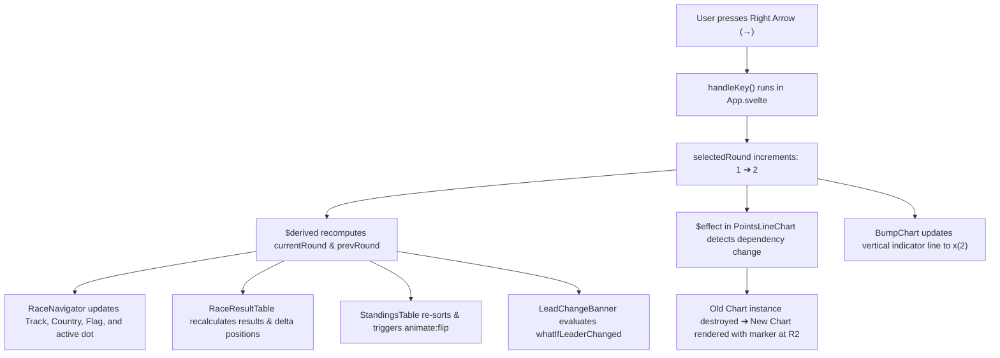

# Svelte 5 Guide for the F1 What-If App

A practical, code-backed companion guide for Jai. This document explains how Svelte 5 works in practice, using real code snippets from this exact repository.

---

## 1. What Svelte 5 Is (For C# & Angular Developers)

Svelte is a component framework that compiles away at build time. Unlike Angular (which uses Zones, Change Detection cycles, and RxJS Observables) or React (which uses a Virtual DOM and `useState` hooks), Svelte compiles components directly into targeted DOM operations.

In Svelte 5, reactivity is driven by **Runes** (`$state`, `$derived`, `$effect`, `$props`). Runes are compiler primitives with zero runtime overhead:
- **No change-detection cycles:** Assigning to a variable immediately updates only the DOM elements bound to it.
- **No observables or subscriptions needed** for basic reactive state.
- **No Virtual DOM diffing:** The compiled output contains direct DOM node mutations.

---

## 2. Project Layout & Source Map

```
src/
├── main.js                          # Application entry point (mounts App to #app)
├── App.svelte                       # Root orchestrator: central state & layout
├── lib/
│   ├── engine.js                    # Pure JS scoring engine (zero Svelte dependencies)
│   ├── teamColors.js                # Constructor hex colors & flag mappings
│   └── components/
│       ├── RaceNavigator.svelte     # Round switcher, track details, & dot timeline
│       ├── RaceResultTable.svelte   # Re-scored classifications with delta badges
│       ├── StandingsTable.svelte    # Cumulative points table with FLIP reorder animations
│       ├── PointsLineChart.svelte   # Interactive Chart.js canvas with auto-teardown
│       ├── BumpChart.svelte         # Responsive D3 SVG rank chart
│       ├── LeadChangeBanner.svelte  # Slide-in banner triggered on leader flips
│       ├── BeneficiariesPanel.svelte# Bar chart ranking points gained without Antonelli
│       └── SeasonScrubber.svelte    # Play/pause automated timeline scrubber
public/data/season.json              # Precomputed season data consumed by the app
```

---

## 3. Codebase Feature Reference & Real Examples

### 3.1 Component Structure: `.svelte` Files
Every component consists of up to three sections: `<script>`, markup template, and `<style>`.

*Real example from [`src/lib/components/LeadChangeBanner.svelte`](file:///Users/jaikumardewani/Projects/alt-f1/src/lib/components/LeadChangeBanner.svelte):*

```svelte
<script>
  import { fly } from 'svelte/transition';
  let { newLeader, prevLeader } = $props();
</script>

<div class="banner" transition:fly={{ y: -16, duration: 380, opacity: 0 }}>
  <span class="crown">👑</span>
  <p>
    <strong>{newLeader?.name ?? 'Unknown'}</strong>
    takes the What-If lead from
    <strong>{prevLeader?.name ?? 'Unknown'}!</strong>
  </p>
</div>

<style>
  .banner {
    display: flex;
    background: linear-gradient(135deg, #1f1500, #2a1e00);
    border: 1px solid var(--accent-2);
    border-radius: var(--radius);
    padding: .7rem 1.2rem;
  }
  strong { color: var(--accent-2); }
</style>
```

---

### 3.2 Reactive State with `$state`
`$state` marks a variable as reactive. Mutating or reassigning it triggers surgical DOM updates wherever that variable is read.

*Real example from [`src/App.svelte`](file:///Users/jaikumardewani/Projects/alt-f1/src/App.svelte):*

```javascript
// Primitive values
let selectedRound = $state(1);
let showWhatIf    = $state(true);
let activeTab     = $state('race');  // 'race' | 'sprint'
let activeChart   = $state('line');  // 'line' | 'bump'

// Objects and arrays (deeply reactive)
let season        = $state(null);
let loading       = $state(true);
```

*When `selectedRound` increments:*
```javascript
// No this.setState(), no this.cdr.detectChanges()
selectedRound++;
```
All derived values and child components listening to `selectedRound` update automatically.

---

### 3.3 Derived Values with `$derived` and `$derived.by`
`$derived` calculates values automatically from other reactive variables. It tracks its own dependencies and caches results until an underlying dependency changes.

#### Single-expression `$derived`
*From [`src/App.svelte`](file:///Users/jaikumardewani/Projects/alt-f1/src/App.svelte):*
```javascript
// Automatically recalculates whenever 'season' or 'selectedRound' changes:
let currentRound = $derived(season?.rounds[selectedRound - 1] ?? null);
let prevRound    = $derived(selectedRound > 1 ? season?.rounds[selectedRound - 2] ?? null : null);

// Fast dictionary lookup for driver metadata:
let driversMap = $derived(
  season
    ? Object.fromEntries(season.drivers.map((d) => [d.id, d]))
    : {}
);
```

#### Complex Multi-statement `$derived.by`
When derivation requires loops or multi-line algorithms, wrap it in a function using `$derived.by`.

*From [`src/lib/components/BumpChart.svelte`](file:///Users/jaikumardewani/Projects/alt-f1/src/lib/components/BumpChart.svelte):*
```javascript
// Recomputes the list of top 10 driver IDs based on the active mode (What-If vs. Real)
let topIds = $derived.by(() => {
  const last = rounds[rounds.length - 1];
  const src  = showWhatIf ? last?.whatIfStandings : last?.realStandings;
  return (src ?? []).slice(0, TOP_N).map((s) => s.driverId);
});

// Recomputes D3 Catmull-Rom scale functions when the container width changes
let xScale = $derived(d3.scaleLinear().domain([1, Math.max(rounds.length, 2)]).range([0, iW]));
let yScale = $derived(d3.scaleLinear().domain([1, TOP_N]).range([0, iH]));
```

---

### 3.4 Side Effects & Lifecycle with `$effect`
`$effect` runs code after DOM updates whenever any reactive value read inside it changes. If you return a function, Svelte automatically executes it as a **cleanup / teardown** function before the next run or upon component unmount.

#### Chart.js Canvas Lifecycle with Auto-Cleanup
*From [`src/lib/components/PointsLineChart.svelte`](file:///Users/jaikumardewani/Projects/alt-f1/src/lib/components/PointsLineChart.svelte):*
```javascript
$effect(() => {
  if (!canvas) return;

  // Reading these makes them reactive dependencies of the effect:
  const _showWhatIf    = showWhatIf;
  const _rounds        = rounds;
  const _selectedRound = selectedRound;
  const _drivers       = drivers;

  const datasets = buildDatasets(_drivers, _rounds, _showWhatIf, _selectedRound);

  const chart = new Chart(canvas, {
    type: 'line',
    data: { labels: _rounds.map((r) => `R${r.round}`), datasets },
    options: { /* ... */ }
  });

  // TEARDOWN: Destroys the Chart instance to prevent canvas memory leaks
  return () => chart.destroy();
});
```

#### ResizeObserver Subscription Teardown
*From [`src/lib/components/BumpChart.svelte`](file:///Users/jaikumardewani/Projects/alt-f1/src/lib/components/BumpChart.svelte):*
```javascript
$effect(() => {
  if (!container) return;
  const obs = new ResizeObserver((entries) => {
    containerW = entries[0].contentRect.width || 700;
  });
  obs.observe(container);

  // Disconnect observer when the component leaves the DOM
  return () => obs.disconnect();
});
```

---

### 3.5 Passing Data Down with `$props`
In Svelte 5, component props are declared with the `$props()` rune, replacing Svelte 4's `export let`.

*From [`src/lib/components/StandingsTable.svelte`](file:///Users/jaikumardewani/Projects/alt-f1/src/lib/components/StandingsTable.svelte):*
```javascript
// Destructure typed/untyped properties passed by the parent
let { round, prevRound, driversMap, showWhatIf } = $props();
```

*From [`src/lib/components/RaceNavigator.svelte`](file:///Users/jaikumardewani/Projects/alt-f1/src/lib/components/RaceNavigator.svelte) (passing callbacks):*
```javascript
// Props can include functions for event communication up to the parent
let { rounds, selectedRound, onSelect } = $props();

// Triggered by button click:
<button onclick={() => onSelect(selectedRound - 1)}>‹</button>
```

---

### 3.6 Template Logic: `{#each}`, `(key)`, `{@const}`, and `{#if}`

#### Keyed Each Blocks with Local Variables (`{@const}`)
The `(key)` is mandatory for items that reorder or animate. It tells Svelte which DOM element belongs to which driver.

*From [`src/lib/components/RaceResultTable.svelte`](file:///Users/jaikumardewani/Projects/alt-f1/src/lib/components/RaceResultTable.svelte):*
```svelte
<tbody>
  <!-- (row.driverId) is the unique key -->
  {#each results as row (row.driverId)}
    <!-- {@const} creates template-scoped variables to simplify expressions -->
    {@const driver = driversMap[row.driverId]}
    {@const color  = getDriverColor(driver)}
    {@const d      = showWhatIf ? delta(row.driverId) : 0}

    <tr animate:flip={{ duration: 280 }} style="--tc: {color}">
      <td class="c-pos">{row.position}</td>
      <td class="c-driver">
        <span class="stripe"></span>
        <span class="code">{driver?.code ?? row.driverId}</span>
        <span class="name">{driver?.name ?? ''}</span>
      </td>
      <td class="c-pts">{row.points}</td>
      {#if showWhatIf}
        <td class="c-delta">
          {#if d > 0}<span class="up">▲{d}</span>
          {:else if d < 0}<span class="dn">▼{Math.abs(d)}</span>
          {:else}<span class="eq">–</span>{/if}
        </td>
      {/if}
    </tr>
  {/each}
</tbody>
```

---

### 3.7 Animations & Transitions (`animate:flip` & `transition:fly`)
Svelte provides built-in FLIP (First, Last, Invert, Play) transition physics with no extra animation libraries.

#### Smooth Row Reordering with `animate:flip`
*From [`src/lib/components/StandingsTable.svelte`](file:///Users/jaikumardewani/Projects/alt-f1/src/lib/components/StandingsTable.svelte):*
```svelte
<script>
  import { flip } from 'svelte/animate';
</script>

<!-- As rounds advance, drivers physically slide up and down to their new rank -->
<tr animate:flip={{ duration: 280 }} style="--tc: {color}">
  <td class="c-pos">{entry.position}</td>
  <!-- ... -->
</tr>
```

#### Entrance & Exit Transitions with `transition:fly`
*From [`src/lib/components/LeadChangeBanner.svelte`](file:///Users/jaikumardewani/Projects/alt-f1/src/lib/components/LeadChangeBanner.svelte):*
```svelte
<script>
  import { fly } from 'svelte/transition';
</script>

<!-- Drops down from above by 16px when a lead change occurs, fades out if false -->
<div class="banner" transition:fly={{ y: -16, duration: 380, opacity: 0 }}>
  ...
</div>
```

---

### 3.8 Bindings (`bind:this`, `bind:checked`, `bind:value`)
Bindings create seamless two-way connections between variables and DOM elements.

#### Canvas DOM Reference with `bind:this`
*From [`src/lib/components/PointsLineChart.svelte`](file:///Users/jaikumardewani/Projects/alt-f1/src/lib/components/PointsLineChart.svelte):*
```svelte
<script>
  let canvas = $state(null); // Will hold the HTMLCanvasElement reference
</script>

<canvas bind:this={canvas}></canvas>
```

#### Two-Way Checkbox Binding with `bind:checked`
*From [`src/App.svelte`](file:///Users/jaikumardewani/Projects/alt-f1/src/App.svelte):*
```svelte
<!-- Toggling the checkbox updates the boolean; modifying the boolean updates the UI -->
<input type="checkbox" bind:checked={showWhatIf} />
```

---

### 3.9 Event Handling & Global Window Listeners

#### DOM Events with `onclick` and `oninput`
Svelte 5 uses standard native attribute naming (`onclick`, `oninput`, `onkeydown`):
```svelte
<button onclick={() => onSelect(selectedRound + 1)}>›</button>
<input type="range" oninput={(e) => onSelect(+e.currentTarget.value)} />
```

#### Global Keyboard Navigation with `<svelte:window>`
*From [`src/App.svelte`](file:///Users/jaikumardewani/Projects/alt-f1/src/App.svelte):*
```svelte
<script>
  function handleKey(e) {
    if (!season) return;
    if (e.key === 'ArrowLeft'  && selectedRound > 1)                   selectedRound--;
    if (e.key === 'ArrowRight' && selectedRound < season.rounds.length) selectedRound++;
  }
</script>

<!-- Listens to keystrokes across the entire window without manual addEventListener cleanup -->
<svelte:window onkeydown={handleKey} />
```

---

### 3.10 Dynamic CSS Custom Properties & Scoped Styling
CSS written inside `<style>` blocks is automatically scoped to the component with a generated class hash (e.g. `.c-pos.svelte-1a2b3c`).

To pass dynamic data (like team colors) into scoped styles, set CSS custom properties on the HTML element:

*From [`src/lib/components/StandingsTable.svelte`](file:///Users/jaikumardewani/Projects/alt-f1/src/lib/components/StandingsTable.svelte):*
```svelte
<tr style="--tc: {color}">
  <td class="c-driver">
    <span class="stripe"></span>
  </td>
</tr>

<style>
  /* Uses the CSS variable injected above */
  .stripe {
    width: 3px;
    height: 18px;
    border-radius: 2px;
    background: var(--tc);
    flex-shrink: 0;
  }
</style>
```

---

### 3.11 Third-Party Integration: D3 & SVG in Svelte 5
Rather than letting D3 mutate the DOM imperatively, modern Svelte uses D3 purely as a **math & geometry engine** (`d3.scaleLinear()`, `d3.line()`, `d3.curveCatmullRom()`), while Svelte renders the SVG declarative markup:

*From [`src/lib/components/BumpChart.svelte`](file:///Users/jaikumardewani/Projects/alt-f1/src/lib/components/BumpChart.svelte):*
```svelte
<svg width={containerW} height={H}>
  <g transform="translate({M.left},{M.top})">
    {#each series as { id, driver, positions }}
      {@const color = getDriverColor(driver)}
      <!-- D3 generates the SVG path string; Svelte renders the element -->
      <path d={makePath(positions)} fill="none" stroke={color} stroke-width="2" />
    {/each}
  </g>
</svg>
```

---

## 4. End-to-End Reactive Flow (What Happens on User Action)

Here is the exact chain reaction when a user presses the right arrow key (`→`):



---

## 5. Svelte 4 vs Svelte 5 Cheat Sheet

If you look up community examples or older tutorials, keep this translation table in mind:

| Concept | Svelte 4 (Legacy) | Svelte 5 (Current Codebase) |
|---|---|---|
| Component state | `let count = 0;` | `let count = $state(0);` |
| Computed values | `$: double = count * 2;` | `let double = $derived(count * 2);` |
| Complex derivations | `$: { /* block */ }` | `let res = $derived.by(() => { ... });` |
| Props | `export let round;` | `let { round } = $props();` |
| Side effects | `$: { if (canvas) update(x); }` | `$effect(() => { update(x); });` |
| Event listeners | `on:click={handleClick}` | `onclick={handleClick}` |
| Lifecycle cleanup | `onDestroy(() => { ... })` | Return function inside `$effect()` |
| Slots | `<slot />` | `{#snippet}` / `children` props |

---

## 6. Suggested Reading Order for the Codebase

1. [`src/lib/engine.js`](file:///Users/jaikumardewani/Projects/alt-f1/src/lib/engine.js): Pure JavaScript calculation logic. Zero UI dependencies.
2. [`src/App.svelte`](file:///Users/jaikumardewani/Projects/alt-f1/src/App.svelte): State management, `$state`, `$derived`, keyboard listener.
3. [`src/lib/components/RaceResultTable.svelte`](file:///Users/jaikumardewani/Projects/alt-f1/src/lib/components/RaceResultTable.svelte): Props, `{#each}` loops, `{@const}` helpers, and delta badges.
4. [`src/lib/components/StandingsTable.svelte`](file:///Users/jaikumardewani/Projects/alt-f1/src/lib/components/StandingsTable.svelte): Position change math and `animate:flip`.
5. [`src/lib/components/PointsLineChart.svelte`](file:///Users/jaikumardewani/Projects/alt-f1/src/lib/components/PointsLineChart.svelte): `$effect` canvas integration with Chart.js and lifecycle destruction.
6. [`src/lib/components/BumpChart.svelte`](file:///Users/jaikumardewani/Projects/alt-f1/src/lib/components/BumpChart.svelte): D3 scales and declarative SVG rendering.
